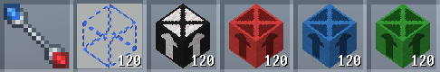

# Structure Building Blocks

Structure Building Blocks (or SBBs) are used to create Blueprints, which can be used to generate structures. Every SBB structure needs a `.zig.zon` file specifying its Blueprints, and its children, if it has any.

### SBB Origin Block

Every Blueprint needs a SBB Origin block. This block is the location that it will be placed in biome generation, as well as its center of rotation. 

The orientation of the block matters. For example, if an SBB structure will be placed on the ground, the SBB origin should be pointing upwards.

### SBB Child Blocks

SBB Child blocks can be used to represent the origin of new child SBBs. This can allow for randomized variations within a structure. They are avaiable in 20 colors, allowing for up to 20 children in one SBB.

The orientation of the child blocks matter. For example, if a child SBB will be placed against the side of the structure, the SBB children should be placed pointing sideways.

### Void Block

When generated in a structure, air blocks present in a Blueprint will stay as air blocks, cutting into surrounding terrain or structures. Void blocks can be used to specify areas of a Blueprint which should be able to be replaced by any block already present in the world.

## Creating Blueprints

In order for an SBB structure to generate, it needs a list of `.blp` Blueprint files. Blueprints can be built in-game and saved using commands. The `cubyz:flat` world preset can make building easier.

When building Blueprints, there are a few items that are important to have on hand:

- `cubyz:selection_wand`
- `cubyz:void`
- `cubyz:sbb/origin`
- Any color(s) of SBB child blocks you may want 

<figure markdown="span">
  
</figure>


## Saving Blueprints

After building your structure, you will need to select it with the Selection Wand. Use left click to place point 1, and right click to place point 2. Once you have your structure selected, use the following commands:

| Command | Description |
| ------- | ----------- |
| `/replace cubyz:air cubyz:void` | Use to replace the air blocks present in the selected volume. If your structure has hollow areas, you may want to keep air blocks inside of those areas to leave them intact. |
| `/copy` | Copies your selection to the clipboard.
| `/toggledecay clipboard on` | *Optional.* Use this if your structure uses branches, leaves, or any other block that can decay. |
| `/blueprint save blueprint_name` | Saves your clipboard as a `.blp` file, and adds it to the `blueprints` folder of your local Cubyz files. |

After saving, move the `.blp` files into your addon's `sbb` folder.

## Creating SBB .zig.zon files

To generate SBB structures, a `.zig.zon` file is needed in your addon's `sbb` folder. A basic SBB `.zig.zon` will look like this:

```zig
.{
	.blueprints = .{
		.{.id = "mod:blueprint/0"},
		.{.id = "mod:blueprint/1", .chance = 0.5},
	},
}
```

The `.id` field must point towards a valid `.blp` file. If you want your structure to have a chance of not generating a blueprint, `.id = null` can be used.

The `chance` of a particular Blueprint can also be specified as a value from 0 to 1. 

### SBB Children

To add child SBBs to our existing SBB `.zig.zon`, we need to specify `.children`:


```zig
.{
	.blueprints = .{
		.{.id = "mod:blueprint/0"},
		.{.id = "mod:blueprint/1", .chance = 0.5},
	},
	.children = .{
		.brown = "mod:child",
	},
}
```

The color name of the child must match the color of the SBB child blocks in your structure. You can specify up to 20 children, one for each color. 
The color field must point towards a new SBB `.zig.zon` file. 

The `mod:child` file could look like this:

```zig
.{
	.blueprints = .{
		.{.id = "mod:child/0"},
	},
}
```

You can add `.children` to this new SBB to chain more SBBs together.

## Loading Blueprints

To place raw Blueprints back into the world, you first need to copy your `.blp` files into your local Cubyz `blueprints` folder. Then, use the following commands:

| Command | Description |
| ------- | ----------- |
| `/blueprint load blueprint_name` | Loads the blueprint onto your clipboard. |
| `/toggledecay clipboard off` | *Optional.* Use this if your blueprint uses branches, leaves, or any other block that can decay. |
| `/paste` | Paste the blueprint into the world relative to your current position. |

## Generating SBB Structures

SBB structures can be generated in a specific biome, or in many biomes using structure tables. Both options use the same nested `.structures` field.

```zig
.structures = .{
	.{
		.id = "cubyz:sbb",
		.structure = "mod:sbb",
		.placeMode = .degradable,
		.chance = 1,
	},
},
```

`.placeMode` controls how the structure will effect existing blocks in the world.

- `.degrabable`: The structure will not replace existing blocks.
- `.all`: The structure will replace existing blocks with it's own.
